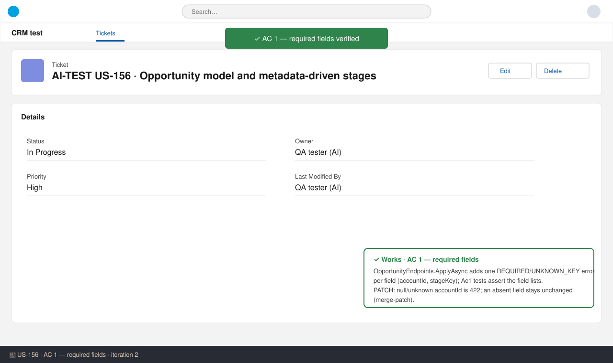
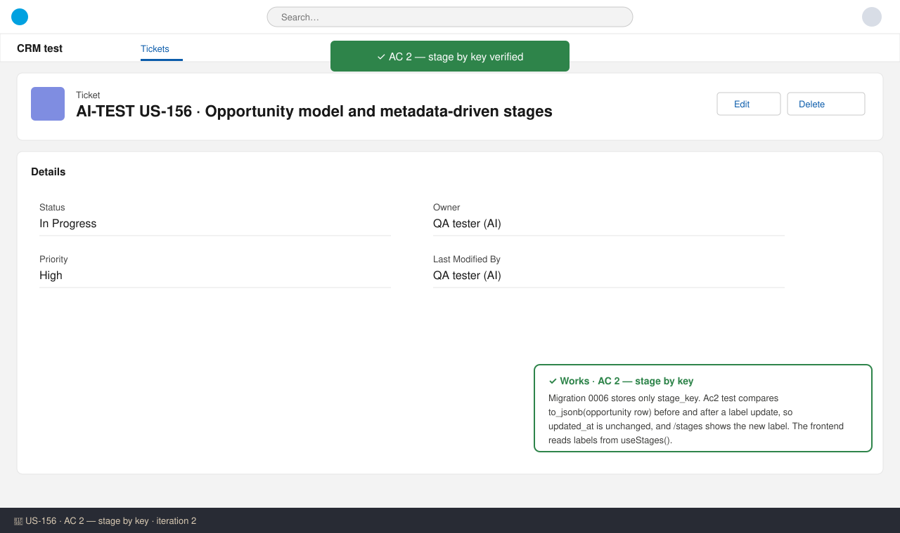
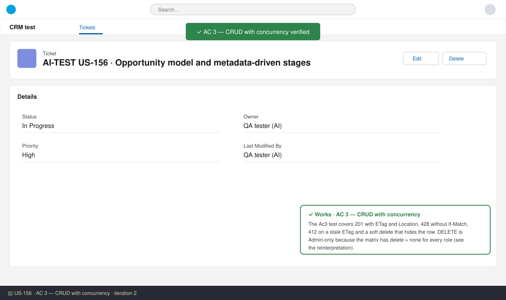
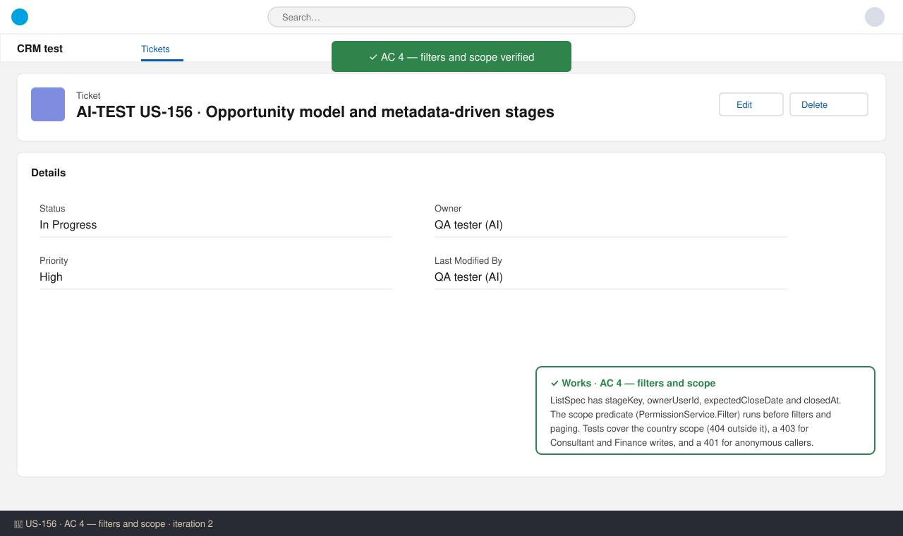
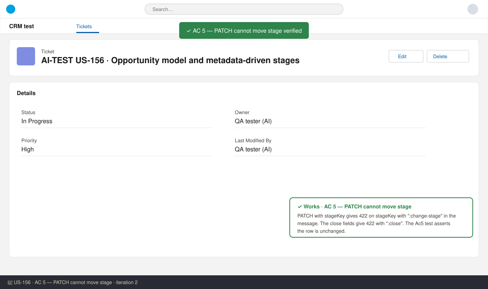

# US-156 — Test report (iteration 2)
**Verdict:** ✅ Approved (with notes) · **Tester:** Cuélebre 🐉 · **Date:** 2026-11-04

## Summary
| Check | Result | Evidence |
|---|---|---|
| AC 1 Required fields | ✅ |  |
| AC 2 Stage by key | ✅ |  |
| AC 3 CRUD with concurrency | ✅ |  |
| AC 4 Filters and scope | ✅ |  |
| AC 5 PATCH can't move stage | ✅ |  |
| Project checks (typecheck, lint, test, build) | ✅ | run_checks passed in this run |
| Project lessons (Respawn, volume seed, PO #82) | ✅ | see below |

## Checks
Static review, because the DB-backed tests are skipped without PostgreSQL. I checked them by hand against the fixtures; their first real run is in CI with ZEPHYR_REQUIRE_DB=1.

- **AC 1:** `ApplyAsync` adds one error per field: `accountId` and `stageKey` (REQUIRED or UNKNOWN_KEY). PATCH with a null or unknown `accountId` gives 422. An absent field stays unchanged (merge-patch).
- **AC 2:** The opportunity stores only `stage_key`. The Ac2 test compares the row's JSON before and after `update stage set label`, so `updated_at` is unchanged. `/api/v1/stages` returns the new label, and the frontend reads labels from `useStages()`.
- **AC 3:** 201 with ETag and Location, 428 without If-Match, 412 on a stale ETag, and a soft delete that hides the row.
- **AC 4:** The list filters on stage, owner, `expectedCloseDate` and `closedAt`. The scope predicate runs before the filters and paging. An out-of-scope row gives 404, and no permission gives 403.
- **AC 5:** 422 for `stageKey` (message points to `:change-stage`) and for the close fields (message points to `:close`).
- **Lessons:** No append-only trigger was added, so Respawn is unaffected (opportunity is cleaned before account by FK order). `04_opportunity.sql` matches the new columns, and `seed.mjs --reset` deletes opportunities before accounts. The stage seeds use the PO #82 exit criteria. No test was dropped by a PO answer.

## Notes (not failures)
- DELETE is Admin-only by role. The permission matrix has `opportunity,delete,none` for every role, including Admin. The code comment says "the matrix defines no delete cell", which is inaccurate. Sent to the PO as a reinterpretation.
- PATCH "without accountId" is read as merge-patch: absent means unchanged and null or unknown means 422. Sent to the PO as a reinterpretation.
- The stage seed has 7 stages, as validate_seeds.py expects. The spec's data model listed 9 (with no_decision and disqualified as terminal stages). These two are close outcomes in `close_outcome`, and the spec marks the stage set as an assumption.
- `docs/api/openapi.json` and its generator metadata have no opportunity or stages routes. `OpenApiContractTests` compares registered routes with that file. Other routes from earlier stories (search, delegations, me/permissions) are also missing, so this predates US-156. Please check it in the first CI run.
- `docs/data/opportunity_stages.seed.json` (PO #82) is not in the workspace, so I could not compare the seed against it. The seed matches the criteria quoted in the PO answer.
- `closedAt` and `stageKey` filters have no leading index (the story specified `(owner_user_id, stage_key)`, `(account_id)` and `(expected_close_date)` only).
